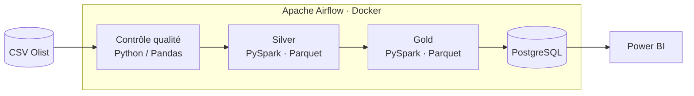

<div align="center">

# 🛒 OmniData

### Du CSV brut à la décision : un pipeline e-commerce automatisé de bout en bout


**Dataset :** [Olist Brazilian E-Commerce](https://www.kaggle.com/datasets/olistbr/brazilian-ecommerce) · **Statut :** ✅ terminé

</div>

---

## En bref

| | |
| :--- | :--- |
| **Problème** | Les données e-commerce sont dispersées dans des fichiers CSV, contiennent des erreurs et ne permettent pas de piloter l'activité. |
| **Solution** | Un pipeline automatisé qui contrôle, nettoie, agrège et publie les données dans un entrepôt PostgreSQL, relié à Power BI. |
| **Volume traité** | **99 441** commandes |
| **Qualité** | **23** commandes aux dates impossibles détectées et marquées invalides |
| **Résultat** | Plus de **97 000** commandes agrégées en couche Gold, pipeline complet en **~2 minutes** |
| **Automatisation** | Un DAG Airflow pilote tout, de l'extraction au chargement |

---

## Le problème métier

Une marketplace brésilienne veut savoir :

1. **Combien elle vend**, et comment son chiffre d'affaires évolue dans le temps.
2. **Où les livraisons sont lentes**, région par région, pour agir sur la satisfaction client.
3. **Qui sont ses clients** : fidèles, occasionnels ou inactifs, afin de cibler ses actions marketing.

Les données brutes ne répondent à aucune de ces questions telles quelles. Il faut d'abord s'assurer qu'elles sont fiables, puis les structurer.

---

## Ce que le projet livre

| Livrable | Contenu |
| :--- | :--- |
| 📊 **Dashboard Ventes** | Chiffre d'affaires, évolution mensuelle, répartition par catégorie et par région |
| 🚚 **Dashboard Livraisons** | Délais réels contre délais promis, retards par région |
| 👥 **Dashboard Clients (RFM)** | Segmentation par Récence, Fréquence et Montant |
| ⚙️ **Pipeline automatisé** | Un DAG Airflow rejouable à chaque nouvelle livraison de données |
| ✅ **Contrôles qualité** | Clés, doublons et cohérence des dates vérifiés avant toute transformation |

---

## Aperçu du Dashboard

*(Remplace ces liens par tes captures une fois ajoutées dans le dossier `docs/`.)*

| Ventes | Livraisons | Clients (RFM) |
| :---: | :---: | :---: |
|  |  |  |

---

## Architecture



Le principe : **chaque couche a une seule responsabilité.**

| Couche | Rôle | Technologie |
| :--- | :--- | :--- |
| **Qualité** | Rejeter ou marquer les données incorrectes avant qu'elles ne se propagent | Python, Pandas, PyArrow |
| **Silver** | Nettoyer, typer et standardiser | PySpark 3.5 (Docker), Parquet |
| **Gold** | Calculer les tables prêtes pour l'analyse (ventes, livraisons) | PySpark, Parquet |
| **Entrepôt** | Servir les données aux outils de BI | PostgreSQL (Docker), SQLAlchemy |
| **Orchestration** | Enchaîner les étapes, relancer en cas d'échec, planifier | Apache Airflow (Docker Compose) |
| **Visualisation** | Rendre les indicateurs lisibles | Power BI Desktop |

---

## Choix techniques

**Pourquoi contrôler la qualité avant de transformer ?**
Une donnée fausse corrigée tard coûte plus cher qu'une donnée rejetée tôt. Les 23 commandes dont les dates sont impossibles (par exemple une livraison avant la commande) sont repérées dès le départ et marquées invalides, au lieu de fausser les délais de livraison plus tard.

**Pourquoi Parquet entre les couches ?**
Le format est colonnaire, compressé et typé. Il conserve les schémas entre deux étapes et rend la lecture par PySpark plus rapide qu'avec des CSV.

**Pourquoi PySpark pour un dataset de cette taille ?**
Le dataset tient en mémoire, mais le code est écrit comme il le serait pour un volume bien plus grand. Passer à un cluster ne demanderait pas de réécrire la logique.

**Pourquoi PostgreSQL avant Power BI ?**
Power BI ne lit pas des fichiers Parquet de façon fiable à grande échelle. L'entrepôt apporte un point d'accès unique, du SQL pour contrôler les résultats et une séparation nette entre traitement et visualisation.

**Pourquoi Airflow ?**
Un pipeline lancé à la main n'est pas un pipeline. Airflow rend l'exécution reproductible, journalisée et relançable étape par étape.

**Pourquoi Docker ?**
L'ensemble (Spark, PostgreSQL, Airflow) démarre avec la même configuration sur n'importe quelle machine.

---

## Segmentation client (RFM)

La segmentation repose sur trois questions posées à chaque client :

| Lettre | Question | Mesure |
| :---: | :--- | :--- |
| **R** : Récence | À quand remonte son dernier achat ? | Jours depuis la dernière commande |
| **F** : Fréquence | Combien de fois a-t-il acheté ? | Nombre de commandes |
| **M** : Montant | Combien a-t-il dépensé ? | Somme des paiements |

Le croisement des trois scores donne des groupes d'action : clients fidèles à récompenser, occasionnels à relancer, inactifs à réactiver.

---

## Exemples de mesures DAX

> Les noms de tables et de colonnes sont indicatifs : adapte-les à ton modèle.

```DAX
Chiffre d'Affaires = SUM ( Ventes[montant_total] )

Nb Commandes = DISTINCTCOUNT ( Ventes[order_id] )

Panier Moyen = DIVIDE ( [Chiffre d'Affaires], [Nb Commandes] )

Délai Moyen Livraison (j) =
AVERAGE ( Livraisons[delai_livraison_jours] )

Taux de Retard =
DIVIDE (
    CALCULATE ( COUNTROWS ( Livraisons ), Livraisons[est_en_retard] = TRUE () ),
    COUNTROWS ( Livraisons )
)

CA Année Précédente =
CALCULATE ( [Chiffre d'Affaires], SAMEPERIODLASTYEAR ( Calendrier[Date] ) )

Croissance CA % =
DIVIDE ( [Chiffre d'Affaires] - [CA Année Précédente], [CA Année Précédente] )
```

---

## Installation et exécution

### Prérequis

- Docker Desktop (avec Docker Compose)
- Git
- Le dataset Olist, à télécharger depuis Kaggle et à placer dans le dossier de données du projet

### Lancement

```bash
# 1. Récupérer le projet
git clone https://github.com/Fatima1234-cheg/<nom-du-depot>.git
cd <nom-du-depot>

# 2. Démarrer les services (Airflow, PostgreSQL, Spark)
docker compose up -d

# 3. Ouvrir l'interface Airflow, activer puis déclencher le DAG du projet
#    → http://localhost:8080
```

> Remplace `<nom-du-depot>` par le nom réel de ton dépôt GitHub, et vérifie le port d'Airflow dans ton `docker-compose.yml`.

### Connexion à Power BI

1. Ouvre Power BI Desktop, puis **Obtenir des données → Base de données PostgreSQL**.
2. Renseigne le serveur, la base et les identifiants définis dans ta configuration Docker.
3. Charge les tables Gold et vérifie les relations dans la vue Modèle.

---

## Pistes d'amélioration

- Tests automatisés sur les transformations PySpark.
- Alertes Airflow (e-mail ou messagerie) en cas d'échec du DAG.
- Passage de l'entrepôt PostgreSQL vers un entrepôt cloud.
- Chargement incrémental plutôt que rechargement complet.

---

## Auteure

**Fatima Chegdani**
Élève ingénieure en Génie Informatique et Intelligence Artificielle — ENSA Safi

[](https://www.linkedin.com/in/fatima-chegdani-44b840274)
[](https://github.com/Fatima1234-cheg)


