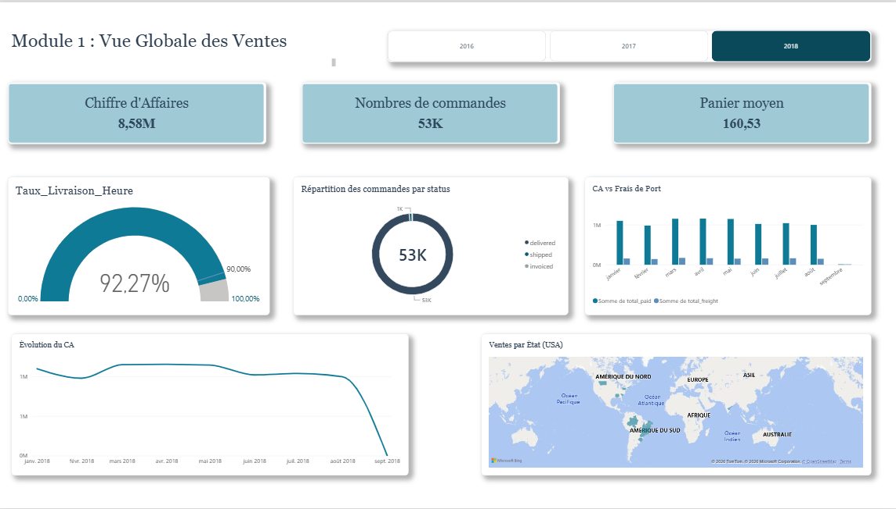
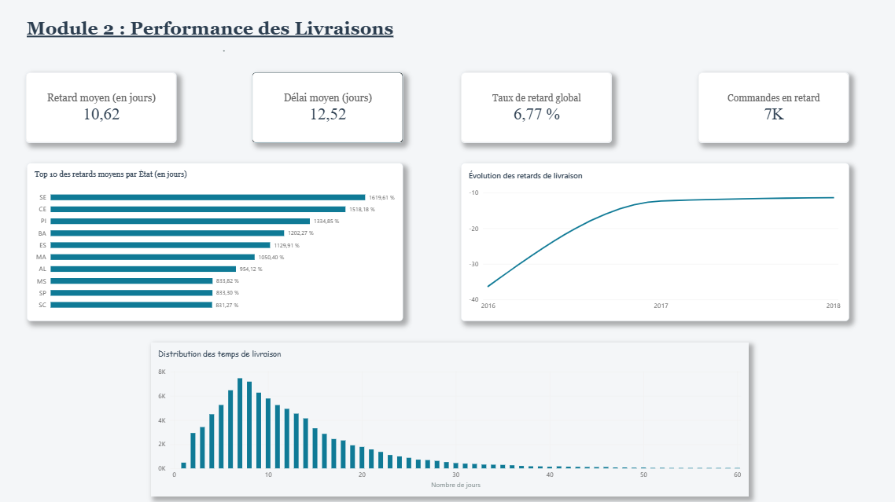
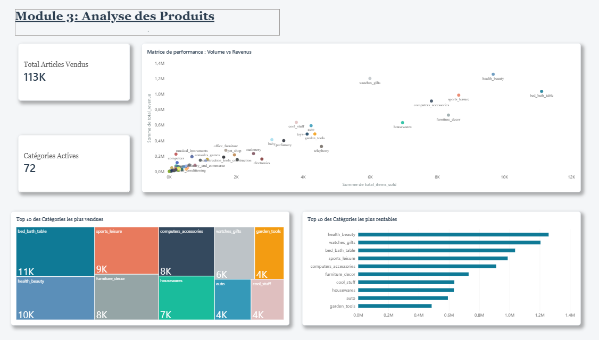
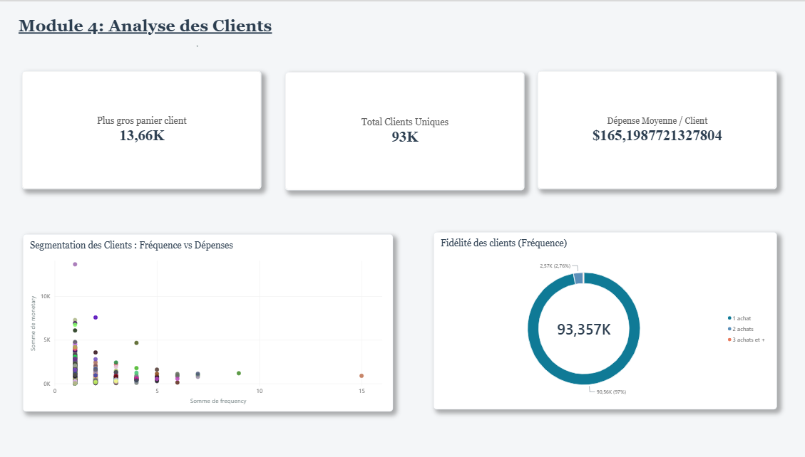
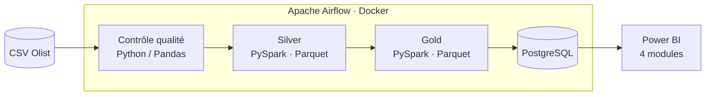

<div align="center">

# 🛒 OmniData

### Du CSV brut à la décision : un pipeline e-commerce automatisé et un dashboard Power BI en 4 modules


**Dataset :** [Olist Brazilian E-Commerce](https://www.kaggle.com/datasets/olistbr/brazilian-ecommerce) (2016 – 2018) · **Statut :** ✅ terminé

</div>

---

## En bref

| | |
| :--- | :--- |
| **Problème** | Les données e-commerce sont dispersées dans des fichiers CSV, contiennent des erreurs et ne permettent pas de piloter l'activité. |
| **Solution** | Un pipeline automatisé par Airflow qui contrôle, nettoie et agrège les données, les charge dans PostgreSQL et les expose dans Power BI. |
| **Volume traité** | **99 441** commandes · **93 357** clients uniques · **113K** articles vendus · **72** catégories |
| **Qualité** | **23** commandes aux dates impossibles détectées et marquées invalides |
| **Gold** | Plus de **97 000** commandes agrégées, pipeline complet en **~2 minutes** |

---

## Les résultats en un coup d'œil

Chiffres lus sur le dashboard (module 1 filtré sur **2018**, les autres modules sur l'ensemble de la période).

| Indicateur | Valeur |
| :--- | :---: |
|  Chiffre d'affaires 2018 | **8,58 M** |
|  Commandes 2018 | **53 K** |
| Panier moyen 2018 | **160,53** |
| Livraisons à l'heure | **92,27 %** |
| Délai moyen de livraison | **12,52 jours** |
| Taux de retard global | **6,77 %** (environ 7 K commandes, retard moyen de 10,62 jours) |
| Clients uniques | **93 K** |
| Clients n'ayant acheté qu'une fois | **97 %** (90,56 K) |
| Plus gros panier client | **13,66 K** |
| Dépense moyenne par client | **≈ 165,20** |

---

## Le dashboard Power BI


### Module 1 : Vue globale des ventes
Chiffre d'affaires, nombre de commandes, panier moyen, taux de livraison à l'heure, répartition des commandes par statut (`delivered`, `shipped`, `invoiced`), chiffre d'affaires face aux frais de port par mois, évolution du CA et carte des ventes par État. Un filtre par année (2016, 2017, 2018) pilote toute la page.



### Module 2 : Performance des livraisons
Délai moyen, taux de retard global, évolution des retards par année, distribution des temps de livraison et top 10 des États aux retards les plus élevés (SE, CE, PI, BA, ES, MA, AL, MS, SP, SC).



### Module 3 : Analyse des produits
Top 10 des catégories par volume et par rentabilité, et matrice de performance croisant articles vendus et revenus pour les 72 catégories actives.



### Module 4 : Analyse des clients
Fidélité par fréquence d'achat (1 achat, 2 achats, 3 achats et plus) et segmentation croisant fréquence et dépenses.



---

## Ce que les données révèlent

| Constat | Lecture métier |
| :--- | :--- |
| **97 % des clients n'achètent qu'une fois.** Seuls 2,76 % reviennent une deuxième fois. | La fidélisation est le plus gros levier de croissance : le coût d'acquisition n'est amorti qu'une fois. |
| **92,27 % des livraisons arrivent à l'heure**, au-dessus du repère de 90 %. | Le service logistique est globalement solide, les retards sont concentrés. |
| **Les retards sont concentrés sur certains États** (SE, CE, PI en tête). | Action ciblée possible sur les transporteurs de ces régions plutôt qu'une refonte globale. |
| **`bed_bath_table` domine en volume (11 K), mais `health_beauty` domine en revenus** (plus de 1,3 M). | Le volume ne fait pas la rentabilité : `watches_gifts` est 7ᵉ en volume mais 2ᵉ en revenus. |
| **Le CA mensuel reste stable autour de 1 M** de janvier à août 2018. | L'activité est régulière, sans saisonnalité marquée sur la période observée. |

---

## Architecture



| Couche | Rôle | Technologie |
| :--- | :--- | :--- |
| **Qualité** | Rejeter ou marquer les données incorrectes avant qu'elles ne se propagent | Python, Pandas, PyArrow |
| **Silver** | Nettoyer, typer et standardiser | PySpark 3.5 (Docker), Parquet |
| **Gold** | Calculer les tables prêtes pour l'analyse (ventes, livraisons, produits, clients) | PySpark, Parquet |
| **Entrepôt** | Servir les données aux outils de BI | PostgreSQL (Docker), SQLAlchemy |
| **Orchestration** | Enchaîner les étapes, relancer en cas d'échec, planifier | Apache Airflow (Docker Compose) |
| **Visualisation** | Rendre les indicateurs lisibles | Power BI Desktop |

---

## Choix techniques

**Contrôler la qualité avant de transformer.** Les 23 commandes aux dates impossibles (par exemple une livraison avant la commande) sont repérées dès le départ et marquées invalides. Elles ne faussent donc pas les délais de livraison du module 2.

**Parquet entre les couches.** Format colonnaire, compressé et typé : il conserve les schémas d'une étape à l'autre et se lit plus vite par PySpark que des CSV.

**PySpark sur un dataset qui tient en mémoire.** Le code est écrit comme pour un volume bien plus grand : passer à un cluster ne demanderait pas de réécrire la logique.

**PostgreSQL entre le Gold et Power BI.** Il offre un point d'accès unique, du SQL pour vérifier les résultats, et sépare nettement le traitement de la visualisation.

**Airflow et Docker.** L'exécution est reproductible, journalisée et relançable étape par étape, avec la même configuration sur n'importe quelle machine.

---

## Segmentation client

Le module 4 croise deux dimensions pour chaque client :

| Dimension | Question | Mesure |
| :--- | :--- | :--- |
| **Fréquence** (`frequency`) | Combien de fois a-t-il acheté ? | Nombre de commandes |
| **Montant** (`monetary`) | Combien a-t-il dépensé ? | Somme des paiements |

Le graphique de dispersion place chaque client selon ces deux axes et fait ressortir les rares clients à la fois fréquents et dépensiers. L'ajout de la **récence** (jours depuis le dernier achat) transformerait cette analyse en segmentation RFM complète.

---

## Exemples de mesures DAX

> Les noms de colonnes viennent du rapport. Les noms de tables sont indicatifs : adapte-les à ton modèle.

```DAX

Nb Commandes = DISTINCTCOUNT ( Ventes[order_id] )

Panier_Moyen = DIVIDE(SUM('public gold_sales_orders'[total_paid]), DISTINCTCOUNT('public gold_sales_orders'[order_id]))

Taux_Livraison_Heure =
DIVIDE (
    CALCULATE ( COUNTROWS ( Livraisons ), Livraisons[est_en_retard] = FALSE () ),
    COUNTROWS ( Livraisons )
)

Taux de Retard = 1 - [Taux_Livraison_Heure]

Total Articles Vendus = SUM ( Produits[total_items_sold] )

Nb_Categories_Actives = DISTINCTCOUNT('public gold_product_categories'[product_category_name_english])

```

---

## Installation et exécution

### Prérequis

- Docker Desktop (avec Docker Compose)
- Git
- Le dataset Olist, à télécharger depuis Kaggle et à placer dans le dossier de données du projet

### Lancement

```bash
# 1. Récupérer le projet
git clone https://github.com/Fatima1234-cheg/omnidata-ecommerce-pipeline.git
cd omnidata-ecommerce-pipeline

# 2. Démarrer les services (Airflow, PostgreSQL, Spark)
docker compose up -d

# 3. Ouvrir l'interface Airflow, activer puis déclencher le DAG du projet
#    → http://localhost:8080 (login: airflow / mdp: airflow)
```


### Connexion à Power BI

1. Ouvre Power BI Desktop, puis **Obtenir des données → Base de données PostgreSQL**.
2. Renseigne le serveur, la base et les identifiants définis dans ta configuration Docker.
3. Charge les tables Gold et vérifie les relations dans la vue Modèle.

---

## Pistes d'amélioration

- Ajouter la récence pour une segmentation RFM complète et des actions marketing par segment.
- Tests automatisés sur les transformations PySpark.
- Alertes Airflow (e-mail ou messagerie) en cas d'échec du DAG.
- Chargement incrémental plutôt que rechargement complet.
- Analyse des causes de retard par État (transporteur, distance, catégorie de produit).

---

## Auteure

**Fatima Chegdani**
Élève ingénieure en Génie Informatique et Intelligence Artificielle — ENSA Safi

[](https://www.linkedin.com/in/fatima-chegdani-44b840274)
[](https://github.com/Fatima1234-cheg)
